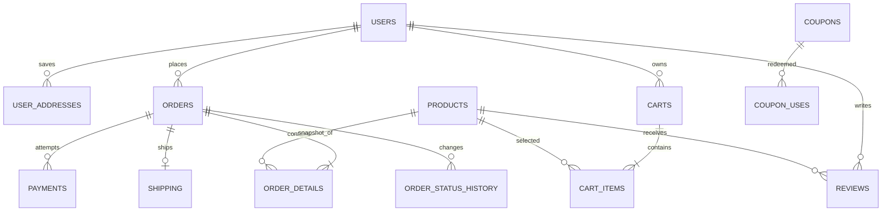
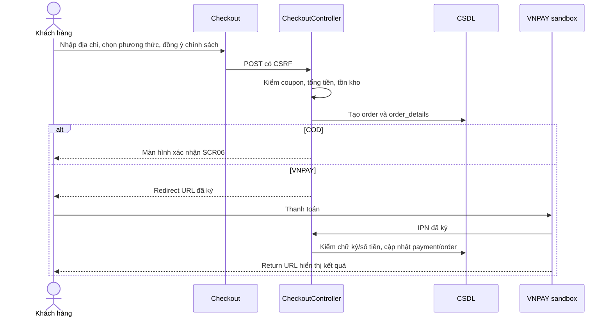
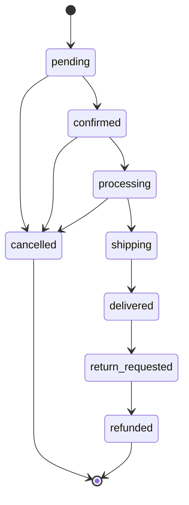

# Hồ sơ phân tích và thiết kế – Vũ Huân Shop

> Bản dự thảo căn cứ mã nguồn hiện có và đề tài cửa hàng thiết bị điện tử B2C. Nhóm cần xác nhận mô hình kinh doanh, người bán pháp lý, chính sách thật, thông tin thành viên và khảo sát thị trường trước khi nộp. Các nhận định dưới đây là khung phân tích, không thay cho khảo sát có dẫn nguồn.

## 1. Đề tài và mô hình kinh doanh

- **Sản phẩm:** điện thoại, laptop, tablet, đồng hồ thông minh và phụ kiện.
- **Loại hình:** B2C, cửa hàng bán trực tiếp cho người tiêu dùng qua website.
- **Doanh thu dự kiến:** biên lợi nhuận sản phẩm/phụ kiện; dịch vụ bảo hành hoặc gói hỗ trợ (cần xác minh thực tế).
- **Giá trị cung cấp:** tìm kiếm/lọc sản phẩm, so sánh thông số, mua trực tuyến, theo dõi đơn, đánh giá sau khi nhận hàng.
- **Kênh:** website, tìm kiếm tự nhiên và mạng xã hội (kế hoạch cần nhóm hoàn thiện).
- **Đối tác:** nhà cung cấp, đơn vị giao hàng, VNPAY sandbox, nhà cung cấp email/hosting.
- **Chi phí:** nhập hàng, hosting/tên miền, vận chuyển, thanh toán, tiếp thị và chăm sóc khách hàng.

### BMC bản nháp

| Thành phần | Nội dung dự kiến |
|---|---|
| Phân khúc khách hàng | Người cần mua thiết bị điện tử; người so sánh cấu hình/giá trước khi mua |
| Giá trị cung cấp | Thông tin sản phẩm và thông số tập trung; đặt mua, thanh toán và theo dõi đơn online |
| Kênh | Website, SEO, mạng xã hội |
| Quan hệ khách hàng | Tài khoản, lịch sử đơn, email giao dịch, hỗ trợ sau bán |
| Dòng doanh thu | Lãi gộp sản phẩm/phụ kiện; dịch vụ bổ sung nếu cửa hàng thực sự cung cấp |
| Nguồn lực chính | Website, dữ liệu hàng hóa, nhân sự bán hàng, nhà cung cấp |
| Hoạt động chính | Quản lý danh mục, cập nhật giá/tồn, đóng gói, giao hàng, chăm sóc sau mua |
| Đối tác chính | Nhà phân phối, vận chuyển, cổng thanh toán, hosting/email |
| Cơ cấu chi phí | Hàng tồn, marketing, nhân công, vận chuyển, nền tảng và dịch vụ số |

## 2. Thị trường và persona

### Khung khảo sát 3 đối thủ (cần nhóm bổ sung ảnh/giá và ngày kiểm tra)

Desk research sơ bộ ngày 01/11/2026: [Thế Giới Di Động](https://www.thegioididong.com/tuu-truong-2026) trình bày các nhóm laptop/điện thoại/tablet trong chiến dịch 2026; [FPT Shop](https://fptshop.com.vn/ho-tro/chinh-sach-bao-hanh) nêu bảo hành theo nhà sản xuất và hỗ trợ chuyển gửi bảo hành miễn phí với điều kiện áp dụng; [CellphoneS](https://cellphones.com.vn/quy-che-hoat-dong-ung-dung-cellphones/chinh-sach-bao-hanh) công bố đổi mới tối đa 30 ngày theo nhóm hàng và có [chính sách giao hàng riêng](https://cellphones.com.vn/chinh-sach-giao-hang). Đây là thông tin trên website chính thức, chưa phải đánh giá UX hay khảo sát khách hàng. Nhóm cần kiểm tra lại chính sách và bổ sung ảnh chụp, giá/điều kiện lấy mẫu, ngày truy cập trước khi nộp.

| Đối thủ tham khảo | Hạng mục cần so sánh | Cơ hội khác biệt cần kiểm chứng |
|---|---|---|
| Thế Giới Di Động | Danh mục, bộ lọc, chính sách giao/bảo hành, trải nghiệm mobile | Tư vấn cấu hình theo nhu cầu hoặc tập trung một phân khúc |
| FPT Shop | Danh mục, thanh toán, trả góp, nội dung sản phẩm | Nội dung so sánh và minh bạch thông số |
| CellphoneS | Danh mục, khuyến mại, giao nhận, đánh giá | Quy trình mua gọn và trải nghiệm cửa hàng địa phương |

Không xem các dòng trên là kết quả khảo sát. Bổ sung URL, ảnh chụp, giá/điều kiện lấy mẫu và nguồn dẫn ở ngày thực hiện.

### Persona giả định cần phỏng vấn xác nhận

1. **Người mua lần đầu (18–25):** ngân sách giới hạn, xem nhiều mẫu, quan tâm giá/khuyến mãi và đánh giá. Cần bộ lọc, so sánh, tư vấn rõ ràng.
2. **Người đi làm (25–40):** cần máy đúng cấu hình, bảo hành và giao hàng đáng tin cậy. Cần thông số dễ đối chiếu, theo dõi đơn và chính sách sau bán.

## 3. Quy tắc nghiệp vụ

- BR01: tổng hàng = tổng số lượng × đơn giá lưu tại thời điểm đặt.
- BR02: tổng thanh toán = tổng hàng + phí vận chuyển − giảm giá; server tự tính lại.
- BR03: coupon chỉ hợp lệ khi đang hoạt động, còn hạn, đạt mức tối thiểu và chưa vượt giới hạn sử dụng.
- BR04: kiểm tra tồn ở checkout; không xác nhận nếu thiếu hàng. Cơ chế khóa đồng thời/giữ hàng tạm thời cần bổ sung trước khi coi là chống oversell hoàn chỉnh.
- BR05: đơn chỉ đi theo chuỗi pending → confirmed → processing → shipping → delivered; hủy trước giao theo ma trận chuyển trạng thái.
- BR06: chỉ đơn đã giao mới được yêu cầu đổi trả và đánh giá.
- BR07: chỉ chuyển return_requested → refunded sau khi quản trị xử lý yêu cầu. Hoàn tiền tự động qua VNPAY chưa được tích hợp.
- BR08: lưu lịch sử chuyển trạng thái gồm trạng thái trước/sau, thời điểm, người thực hiện và ghi chú.
- BR09: hủy đơn phục hồi số lượng tồn ở cấp sản phẩm; biến thể hiện chưa có tồn riêng.

## 4. Tác nhân và danh sách use case

Tác nhân: Khách vãng lai, Khách hàng, Quản trị viên/Nhân viên, VNPAY (sandbox), Đơn vị vận chuyển (hiện chưa tích hợp API).

| Mã | Use case | Trạng thái mã nguồn |
|---|---|---|
| UC01 | Đăng ký, đăng nhập, quản lý tài khoản/sổ địa chỉ | Có; đăng nhập sai tạm khóa theo session hiện tại |
| UC02 | Xem, tìm kiếm, lọc, sắp xếp sản phẩm | Có |
| UC03 | Quản lý giỏ hàng | Có; gộp giỏ khách cần kiểm tra giữ biến thể |
| UC04 | Đặt hàng | Có; cần kiểm thử cạnh tranh tồn kho |
| UC05 | Áp dụng mã giảm giá | Có |
| UC06 | Thanh toán trực tuyến | Có tích hợp VNPAY sandbox return/IPN; cần test theo sandbox |
| UC07 | Theo dõi, hủy đơn | Có; thêm kiểm tra chuyển trạng thái |
| UC08 | Yêu cầu đổi trả/hoàn tiền | Có yêu cầu và trạng thái; chưa có quy trình logistics/refund tự động |
| UC09 | Đánh giá sản phẩm | Chỉ đơn đã giao |
| UC10 | Quản lý danh mục, sản phẩm, biến thể, tồn kho | Có; tồn biến thể/SKU riêng còn thiếu |
| UC11 | Xử lý đơn và tạo vận đơn | Xử lý đơn có; tạo vận đơn qua API chưa có |
| UC12 | Quản lý khuyến mãi/coupon | Có |
| UC13 | Quản lý khách hàng | Có |
| UC14 | Báo cáo, thống kê | Có báo cáo cơ bản và xuất đơn |
| UC15 | Nội dung/chính sách | Có trang nội dung/chính sách |

## 5. Đặc tả tóm tắt use case bắt buộc

### UC04 – Đặt hàng

- **Tác nhân/tiền điều kiện:** khách đăng nhập, giỏ có hàng, hàng đang bán.
- **Luồng:** mở checkout → nhập người nhận/địa chỉ → xác nhận chính sách dữ liệu và điều khoản → server xác thực coupon, giá, tồn → tạo đơn và chi tiết → COD xác nhận hoặc chuyển đến cổng → email xác nhận.
- **Ngoại lệ:** thiếu hàng, coupon hết hạn, dữ liệu không hợp lệ hoặc chưa đồng ý thì từ chối và không tạo đơn.
- **Màn hình:** SCR01–SCR05. **Quy tắc:** BR01–BR05.

### UC05 – Áp dụng coupon

- **Tiền điều kiện:** giỏ có hàng.
- **Luồng:** nhập mã → server xác thực hiệu lực, mức tối thiểu, giới hạn → tính mức giảm → hiển thị tổng mới.
- **Ngoại lệ:** mã sai/hết hạn/vượt lượt/không đạt mức tối thiểu thì không áp dụng.
- **Màn hình:** SCR04–SCR05. **Quy tắc:** BR02–BR03.

### UC06 – Thanh toán trực tuyến

- **Luồng:** tạo yêu cầu VNPAY có chữ ký → chuyển hướng cổng sandbox → cổng gửi IPN → server kiểm tra chữ ký, mã đơn, số tiền và trạng thái → ghi nhận kết quả; return URL chỉ hiển thị kết quả cho khách.
- **Ngoại lệ:** hủy/thất bại/sai chữ ký/IPN trùng; không ghi nhận thanh toán thành công nếu xác thực không đạt.
- **Màn hình:** SCR05–SCR06. Không lưu thông tin thẻ.

### UC09 – Đánh giá sản phẩm

- **Tiền điều kiện:** đăng nhập, đơn của khách đã giao chứa sản phẩm, chưa gửi đánh giá.
- **Luồng:** gửi điểm/nội dung → kiểm tra đơn đã giao → tạo đánh giá chờ duyệt → quản trị duyệt/từ chối.
- **Màn hình:** SCR03, trang đơn và trang đánh giá.

### UC11 – Xử lý đơn

- **Tiền điều kiện:** nhân viên có quyền, đơn tồn tại.
- **Luồng:** xem đơn → chuyển trạng thái hợp lệ → ghi người thao tác/thời gian/lý do → email khách.
- **Ngoại lệ:** chuyển trạng thái sai bị từ chối; yêu cầu đổi trả chỉ sau giao; refund chỉ sau xử lý yêu cầu.
- **Lưu ý:** API đơn vị vận chuyển chưa được hiện thực.

## 6. Kiến trúc, dữ liệu và bảo mật

- **Kiến trúc:** trình duyệt → front controller `index.php` → controller/model/view MVC → MySQL hoặc SQL Server; dịch vụ ngoài gồm VNPAY, SMTP và Gemini (nếu bật).
- **Triển khai:** PHP hosting/VPS + DB + HTTPS; điền tên miền, chứng chỉ, cấu hình backup vào `DEPLOYMENT.md` sau khi xác nhận thực tế.
- **Thực thể:** users/roles, categories/products/product_images/product_specs, carts/cart_items, orders/order_details, payments, shipping, coupons/coupon_uses, reviews, user_addresses, order_status_history.
- **Lưu ý ERD:** product variants hiện là JSON trong `products.variants_json`; chưa đạt biến thể chuẩn hóa với SKU/tồn theo từng lựa chọn.
- **Bảo mật:** bcrypt, prepared statements, escape output, CSRF, role guard, VNPAY checksum. Rate limit đăng nhập hiện chỉ theo session+IP nên chưa chống phân tán tốt. Cần rà XSS/SQLi, quyền xem đơn, HTTPS và secrets trước triển khai.
- **Dữ liệu cá nhân:** tên, số điện thoại, email, địa chỉ phục vụ đặt/giao/bảo hành; checkout có xác nhận consent; ghi nhận thời điểm/phiên bản consent trong DB là phần nên bổ sung để có bằng chứng.

## 7. Giao diện

Sơ đồ trang và 8 wireframe / 3 mockup mức giao diện nằm trong [`WIREFRAMES.html`](WIREFRAMES.html) và [`MOCKUPS.html`](MOCKUPS.html). Chụp ảnh thực tế từng màn hình rồi bổ sung so sánh với mockup trước khi nộp.

## 8. Biểu đồ thiết kế nguồn

### ERD rút gọn

ERD này mô tả bảng hiện có và hai bảng mới. Biến thể cần tách thành PRODUCT_VARIANTS (variant_id, product_id, SKU, attributes, price_delta, stock_quantity) trong giai đoạn tiếp theo.

### UC04/UC06 – Đặt hàng và thanh toán

### Vòng đời đơn hàng

